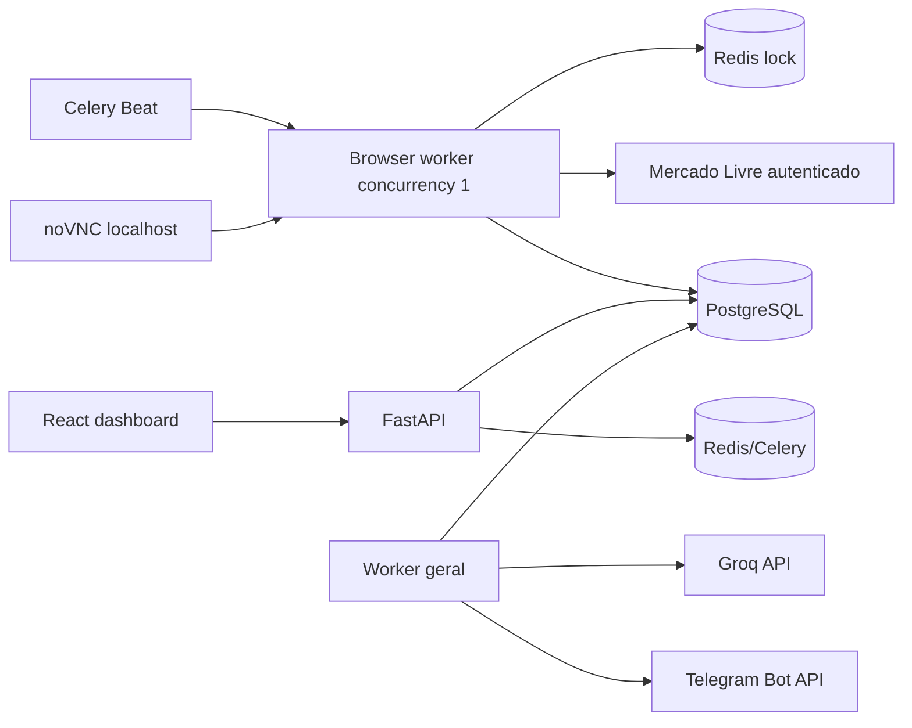

# Arquitetura

Visão geral dos principais componentes e limites do projeto.



## Limites dos módulos

- `MarketplaceProvider`: descoberta profunda e revalidação pelas páginas oficiais.
- `AffiliateProvider`: autenticação, cupons e geração de link.
- `MercadoLivreAffiliateHubParser`: conversão de HTML em produto normalizado.
- `OfferScoringEngine`: cálculo puro, configurável e explicável.
- `OfferPipeline`: persistência, snapshots, score, filtros, deduplicação e fila.
- `MercadoLivreBrowserService`: única fronteira autorizada para o Hub autenticado.
- `GroqCopyGenerator`: saída estruturada e fallback determinístico.
- `TelegramService`: separação rígida entre smoke privado e publicação pública.

## Estados

Sessão do navegador:

```text
AUTH_REQUIRED -> AUTHENTICATED
AUTHENTICATED -> SESSION_EXPIRED
AUTHENTICATED -> AUTH_CHALLENGE_REQUIRED
SESSION_EXPIRED/AUTH_CHALLENGE_REQUIRED -> AUTHENTICATED (intervenção manual)
```

Fila:

```text
DISCOVERED -> SELECTED -> LINK_PENDING -> CREATIVE_PENDING -> READY
READY -> DRY_RUN
READY -> PUBLISHING -> PUBLISHED
qualquer etapa transitória -> RETRY -> FAILED
qualquer etapa administrativa -> SKIPPED
```

## Invariantes

- Um único processo manipula o perfil do navegador.
- Snapshots são imutáveis; uma nova versão é registrada quando os fatos mudam.
- Dados ausentes permanecem `null` e não recebem nota zero automaticamente.
- A aplicação valida somente o formato e o resultado exibido para links afiliados.
- Comissão nunca faz parte do conteúdo público.
- Cupons só aparecem quando a elegibilidade está confirmada.
- Publicação afiliada exige as quatro travas de ambiente para o modo público.
